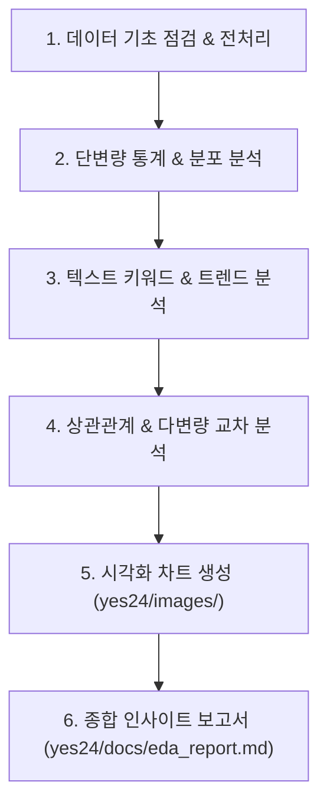

# Yes24 베스트셀러 데이터셋 EDA (Exploratory Data Analysis) 계획서

## 1. 분석 개요 및 목적
- **대상 데이터**: [`../data/yes24_bestseller.csv`](../data/yes24_bestseller.csv) (IT/모바일 베스트셀러 1위~1,000위 도서 데이터 1,000건)
- **분석 목적**:
  1. IT 도서 시장의 가격, 판매지수, 평점, 리뷰 분포 등 **기초 데이터 통계 및 특성 파악**
  2. 도서명/부제목 키워드 분석을 통한 **최신 IT/기술 트렌드(AI, 클로드, 파이썬 등) 도출**
  3. 주요 출판사별 점유율 및 출간 시기별 판매지수 분석을 통한 **베스트셀러/스테디셀러 패턴 규명**
  4. 수집 데이터의 결측치 및 이상치를 점검하여 **데이터 품질 검증**

---

## 2. 분석 프레임워크 및 단계별 흐름



---

## 3. 세부 분석 항목 및 방법

### Step 1: 데이터 무결성 및 전처리 (Data Preparation)
- **데이터 크기 및 스키마 확인**: 행(1,000건), 열(18개) 및 데이터 타입 점검
- **결측치(Missing Values) 진단**:
  - `rating`, `review_count` 결측/0건 비율 점검
  - `subtitle`, `delivery_info` 결측 패턴 확인
- **파생 변수 생성**:
  - `pub_year`, `pub_month`: `pub_date`('2026년 08월')에서 연도 및 월 분리
  - `discount_amount`: 정가(`original_price`) - 판매가(`sale_price`)
  - `author_count`: 공저자 수 계산
  - `title_length`: 도서명 글자 수

### Step 2: 단변량 분석 (Univariate Analysis)
- **수치형 지표 분포 분석**:
  - **판매가(`sale_price`) & 정가(`original_price`)**: 평균, 중위수, 왜도, 사분위수(IQR), 박스플롯
  - **판매지수(`sales_index`)**: 롱테일(Long-tail) 분포 분석 (로그 스케일 변환 포함)
  - **평점(`rating`) & 리뷰수(`review_count`)**: 평점 집중 구간 및 리뷰 수 분포
- **범주형 지표 분석**:
  - **출판사 점유율 TOP 10**: 도서 등록 건수 및 시장 점유율(%)
  - **다작 저자 TOP 10**: 베스트셀러 진입 도서가 가장 많은 저자
  - **출간 연도별 분포**: 신간(2025~2026) vs 구간(스테디셀러) 비율

### Step 3: 도서명 텍스트 키워드 & 트렌드 분석 (Text & Trend Mining)
- **핵심 키워드 빈도 추출**: 도서명(`title`) 및 부제(`subtitle`)에서 형태소/명사/외래어 토큰 추출
- **주요 테마별 비중 분석**:
  - 생성형 AI (클로드, ChatGPT, 제미나이, 프롬프트, 바이브 코딩 등)
  - 전통 프로그래밍 언어 (파이썬, C#, 자바, SQL, JavaScript 등)
  - 업무 생산성 / 오피스 (엑셀, 유튜브 영상 편집, 숏폼, 캔바, 노션 등)
  - 인프라 / 백엔드 / 데이터 (카프카, 클라우드, 데이터 분석, 리액트 등)
- **워드클라우드 및 상위 키워드 막대 차트 생성**

### Step 4: 상관관계 및 교차 분석 (Bivariate & Multivariate Analysis)
- **변수 간 상관관계**: 판매지수, 평점, 리뷰수, 판매가, 할인율 간의 피어슨/스피어만 상관계수 히트맵
- **판매지수와 주요 요인의 관계**:
  - 순위(Rank) vs 판매지수(Sales Index) 감쇠 곡선
  - 리뷰 수와 판매지수 간의 산점도 (리뷰가 판매에 미치는 영향)
- **출판사별 비교 분석**:
  - 상위 5대 출판사의 평균 도서 가격, 평균 판매지수, 평균 평점 비교
- **출간 연도별 판매지수 비교**:
  - 연도별 출간 도서의 판매지수 비교를 통한 스테디셀러 파워 검증

---

## 4. 시각화 및 산출물 계획

### 4-1. 생성될 시각화 이미지 (`yes24/images/`)
한글 폰트(Malgun Gothic)를 적용한 고해상도(DPI 300) 차트 저장:
1. `01_price_distribution.png`: 판매가 및 정가 분포 (히스토그램 & Boxplot)
2. `02_sales_index_distribution.png`: 판매지수 분포 및 순위별 감쇠 곡선
3. `03_top_publishers.png`: 출판사 점유율 TOP 10 막대 차트
4. `04_top_keywords.png`: 도서명 주요 트렌드 키워드 TOP 20 빈도 차트
5. `05_correlation_heatmap.png`: 주요 수치형 변수 간 상관계수 히트맵
6. `06_pub_year_vs_sales.png`: 출간 연도별 도서 수 및 평균 판매지수 비교

### 4-2. 워크스페이스 산출물 구조
```
yes24/
├── data/
│   └── yes24_bestseller.csv       # 원본 수집 데이터 (1,000건)
├── docs/
│   ├── yes24_scraping_spec.md     # 수집 명세서
│   ├── eda_plan.md                # EDA 계획서 (본 문서)
│   └── eda_report.md              # EDA 분석 종합 보고서 (인사이트, 표, 시각화 포함)
├── images/                        # 생성된 차트 이미지 6종
└── src/
    ├── scraper.py                 # 스크래퍼 코드
    └── eda.py                     # EDA 분석 및 시각화 생성 스크립트
```

---

## 5. 필요 패키지
- `matplotlib`, `seaborn` (차트 시각화 및 한글 폰트 지원)
- `pandas`, `numpy` (기존 설치 완료)
