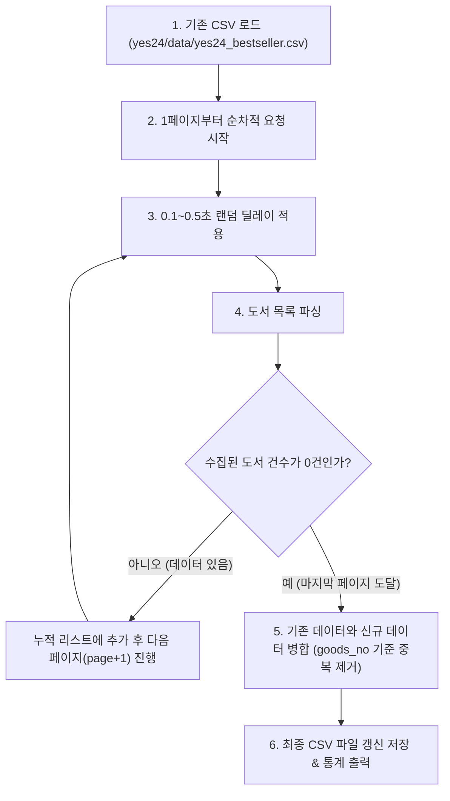

# Yes24 베스트셀러 전수 수집 및 증분/병합 저장 계획서

## 1. 개요
- **목적**: 1페이지부터 데이터가 존재하지 않는 마지막 페이지까지 자동으로 탐색하며 전체 도서 데이터를 수집하고, 기존 CSV 파일과 병합하여 중복 없이 갱신 저장합니다.
- **수집 간격**: 매 페이지 요청마다 `0.1 ~ 0.5초` 랜덤 지연(sleep) 적용

---

## 2. 세부 구현 방안

### 2-1. 동적 마지막 페이지 탐색 (Auto-Pagination)
- 고정된 `end_page` 대신 `page = 1`부터 시작하여, 응답받은 도서 리스트의 길이가 0이 될 때까지 자동으로 페이지를 증가시키며 수집합니다.
- 최대 안전 한계(Max Safety Limit: 100페이지 등)를 두어 무한 루프를 방지합니다.

### 2-2. 기존 CSV 데이터 병합 (Merge & Deduplication)
- 기존 [`../data/yes24_bestseller.csv`](../data/yes24_bestseller.csv) 파일이 존재하면 `pd.read_csv()`로 로드합니다.
- 새로 수집된 데이터와 `goods_no`를 기준으로 중복을 확인하고, 최신 순위와 메타데이터로 갱신 병합합니다.
- 병합 후 순위(`rank`) 기준으로 오름차순 정렬하여 저장합니다.

### 2-3. 로깅 및 저장
- 페이지별 수집 건수, 누적 건수, 신규 추가/갱신 건수를 실시간 로그로 출력합니다.
- 최종 결과를 [`../data/yes24_bestseller.csv`](../data/yes24_bestseller.csv)에 `utf-8-sig` 인코딩으로 덮어씁니다.
